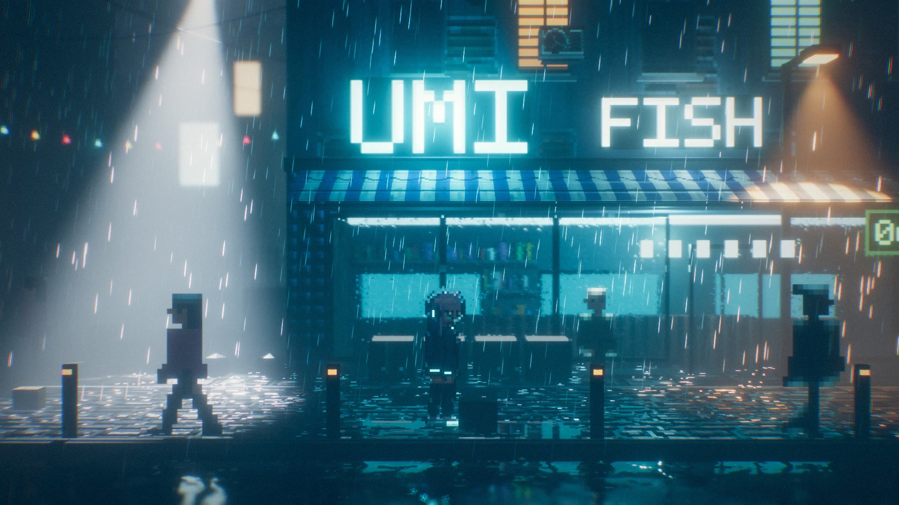
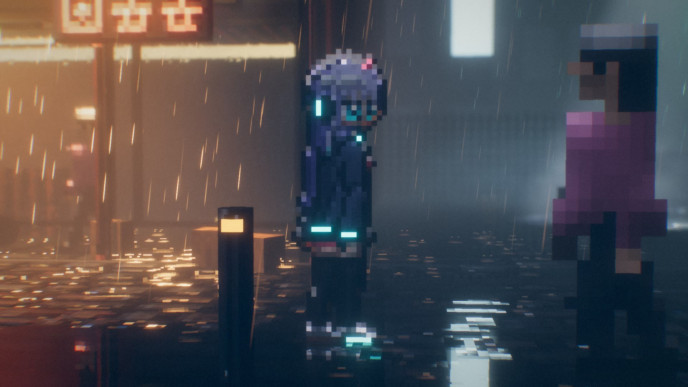

# The Last Night — 致敬场景（WebGL2 / three.js）

**在线体验：<https://the-last-night-tribute.pages.dev>**（桌面浏览器 + 独显/Apple Silicon 效果最佳）



一个可在浏览器中实时运行的赛博朋克雨夜街道，目标是尽量复刻《The Last Night》的
"2D 像素美术 + 3D 实时光照" 画面风格。所有资产（建筑、招牌、角色、动画）都是代码
程序化生成的，**没有使用原游戏的任何文件**。

整个项目由 Claude Opus 5.5（Claude Code）根据**一句话指令**独立完成：从研究原作截图、
搭渲染管线、写着色器，到画像素主角、调试修 bug，全程约 86 分钟，期间没有任何人工补充指令。

> 这是粉丝向的技术致敬，与 Odd Tales、Raw Fury 及《The Last Night》官方无关。



## 运行

```bash
npm install
npm run dev
```

打开 `http://127.0.0.1:5173/`。画质参数：`?q=low|med|high`（默认 med），或用 `?w=1920` 固定内部渲染宽度。

| 按键 | 作用 |
| --- | --- |
| A / D、← / →（或按住屏幕左右半边） | 行走 |
| Shift | 奔跑 |
| C | 角色特写镜头 |
| L | 立即触发闪电 |
| R | 开 / 关雨 |
| F / G / B | 开关体积雾 / 景深 / 泛光 |
| H | 隐藏 HUD |

## 画面是怎么做出来的

原作的关键在于：美术是像素的，但光照、雾、反射都是真 3D 的。这里也一样，整个场景是
3D 几何体 + 像素纹理，渲染管线如下（`src/render/pipeline.js`）：

1. **平面反射**：从镜像相机渲染一次（带斜裁剪平面），再做纵向拉长的模糊，用来模拟湿漉漉
   街道上被拉长的霓虹倒影。
2. **主渲染（4x MSAA，HDR）**：像素纹理全部是最近邻采样，配合由高度图生成的逐像素法线贴图，
   所以每一块砖、每一个像素都会对动态光产生明暗。
3. **湿地面 / 水面**（`materials.js: makeWet`）：程序化水洼遮罩、雨滴涟漪、菲涅尔、
   粗糙度相关的反射混合；运河水面另加波浪法线。
4. **玻璃**（`makeGlass`）：采样不透明场景的拷贝做折射，玻璃上有静态水珠和顺着往下流的
   水滴（带水痕），可选磨砂。
5. **体积雾**（半分辨率 ray march，`shaders.js: fogFrag`）：高度雾 + 3D 噪声风动 + 局部
   烟雾体积（拉面店蒸汽、小巷）。聚光灯直接复用 shadow map 做 **带阴影的体积光柱**
   （路灯、无人机探照灯、出租车大灯），点光源用解析积分求散射（霓虹、窗户、灯串）。
   最后用深度感知的双边上采样合成回全分辨率。
6. **雨**：GPU 实例化雨丝和地面水花，逐像素被同一套灯光列表照亮（所以只在光柱里闪亮），
   手动和场景深度做比较。雨滴位于**世界坐标固定的周期体积**中，不会跟着镜头 / 角色移动；
   近景和远景两层。
7. **景深**（散射式 gather bokeh），焦点自动跟随角色；**泛光**（13 tap 下采样 / tent
   上采样 mip 链）；**最终调色**：ACES、色差、暗角、胶片颗粒、2.39:1 宽银幕画幅。

### 光源调度

街上有上百个光源。`LightManager` 每帧把离焦点最近的若干个虚拟光源映射到固定数量的
`PointLight` 槽位上（光源数量不变，shader 不会重编译）；其余光源只参与雾的散射和精灵描边。
带阴影的聚光灯由 `SpotPool` 在路灯 / 无人机 / 出租车之间竞争分配。

### 2D 精灵的光照（`src/world/sprites.js`）

精灵是放在 3D 空间里的面片，在 `MeshStandardMaterial` 基础上注入了一套专门的光照：

* **体积感法线**：由模糊后的剪影生成，所以角色像有圆润厚度一样受光，也会投射 / 接收阴影；
* **轮廓光（rim）**：所有附近光源（包括只存在于雾里的招牌、窗户光）会照亮剪影朝向该光的
  那一侧边缘；位于角色身后的光会包裹整个轮廓，形成原作那种逆光剪影；
* **闪电**：闪电发生时，一个只在闪电期间更新 shadow map 的方向光从一侧打亮整个街道，
  同时精灵剪影朝向闪电的一侧边缘被硬光勾亮；天空云层被从内部照亮，远处出现闪电光柱。
  闪电是多次频闪 + 衰减拖尾，每 9–25 秒随机一次，按 L 可手动触发。

### 主角（`src/world/heroine.js`）

二次元风格少女：银紫色长发（带高光环和发梢挑染）、青色眼睛、耳机、宽松外套（霓虹包边）、
百褶短裙、过膝袜和露出的大腿、LED 鞋底。精灵以每米 32 texel 绘制（路人为 16），由一个
小骨骼逐帧摆姿势后光栅化：卡通分色的胶囊体四肢、手绘五官像素、彩色描边（sel-out），
以及头发、裙摆、外套下摆的二级运动。动画：行走 8 帧、奔跑 8 帧、待机 8 帧（呼吸 + 眨眼）。
`sprite.html` 可以放大查看精灵表（`?z=缩放&from=起始帧&n=帧数`）。

## 目录

```
src/core/     随机数、像素绘图、纹理库、几何拼装工具、像素字体
src/render/   渲染管线、全屏 pass shader、湿地面 / 玻璃 / 全息材质、光源管理
src/world/    街道、背景城市、雨、路人与主角精灵、无人机与悬浮出租车
```
